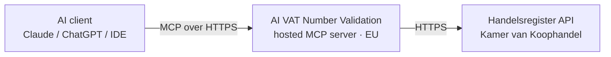

# How the connection works

Three parties, and that is the whole picture. There is no synchronisation, no copy of any data
on our side, and no background process.

Your question goes to the hosted server, the server asks the register, and the answer comes back
through the same path. It is used to answer you and is not kept afterwards as a stored copy. We
do not keep a record of which companies you looked up.

## Signing in

You sign up once with an email address and the KVK number of your own organization. You get a
sign-in link by email; there are no tokens to paste into a client config, and there is no
account at the Kamer van Koophandel that you need yourself.

## What we do keep

Your email address, the KVK number of your organization, a session, and a monthly usage counter
so the allowances can be enforced. See
[PRIVACY.md](https://github.com/iwebdevnl/ai-vat-number-validation/blob/main/PRIVACY.md).

The authoritative terms are in iWebDevelopment's AV/DPA.
