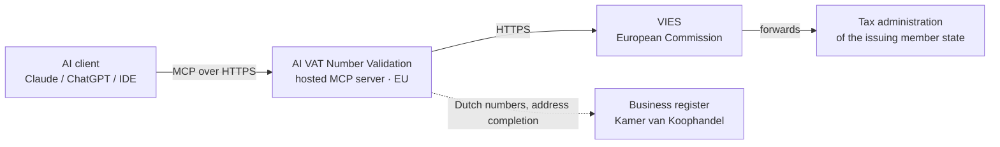

# How the connection works

There is no synchronisation, no copy of any data on our side, and no background process.

Your question goes to the hosted server, the server asks VIES, and VIES forwards it to the tax
administration of the member state that issued the number. That is why availability differs per
member state: one country can be offline while the rest answer normally.

The dotted line is the second register. For a Dutch VAT number given with a company name but no
address, the name is sent to the Dutch business register to complete the address before the
cross-check runs. Supply an address yourself, or pass `use_kvk: false`, and that step is skipped.

Answers are used to reply to you and are not kept afterwards as a stored copy. We do not keep a
record of which VAT numbers you checked.

## Signing in

You sign up once with an email address and the VAT number of your own organization. You get a
sign-in link by email; there are no tokens to paste into a client config.

Your own VAT number is what VIES issues the consultation number to, so it is the reason evidence
is available at all, not an administrative formality.

## What we do keep

Your email address, your organization's VAT number, a session, and a monthly usage counter so the
allowances can be enforced. See
[PRIVACY.md](https://github.com/iwebdevnl/ai-vat-number-validation/blob/main/PRIVACY.md).

The authoritative terms are in iWebDevelopment's AV/DPA.
